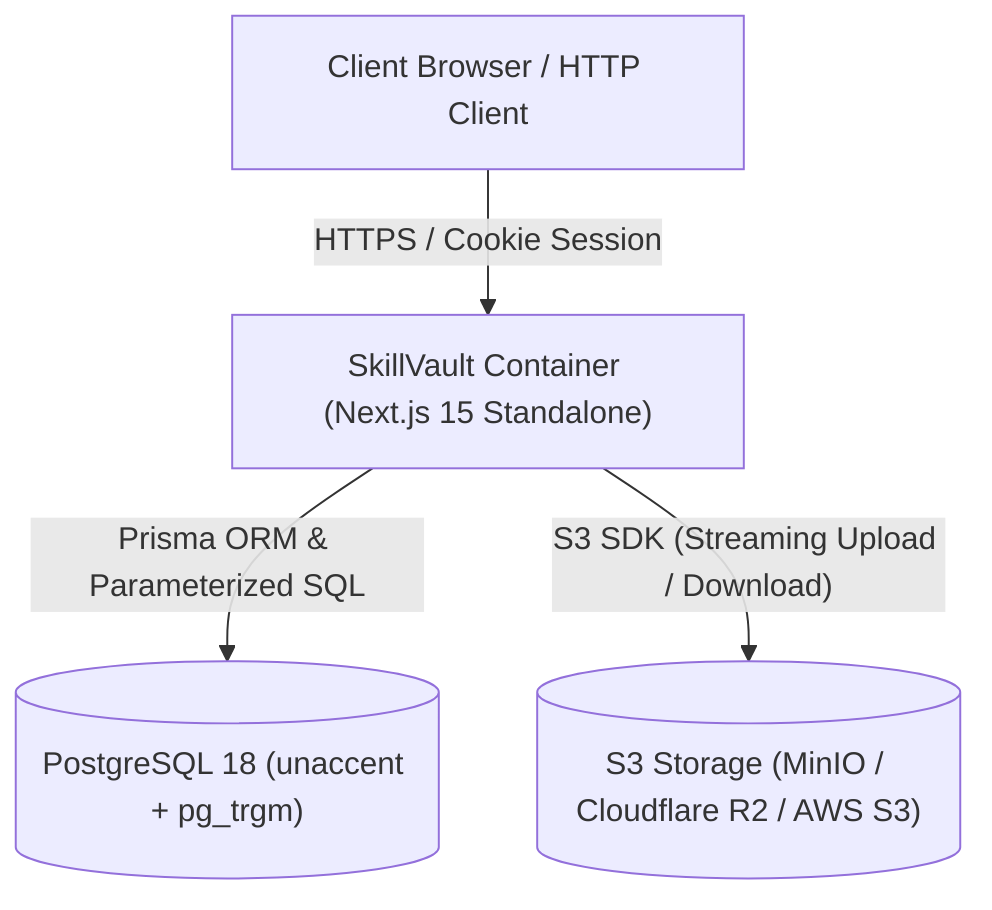
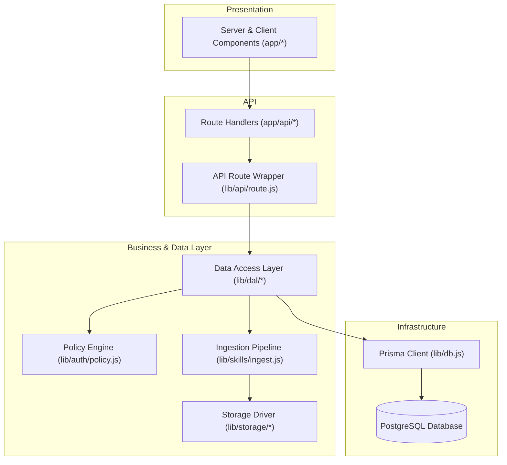
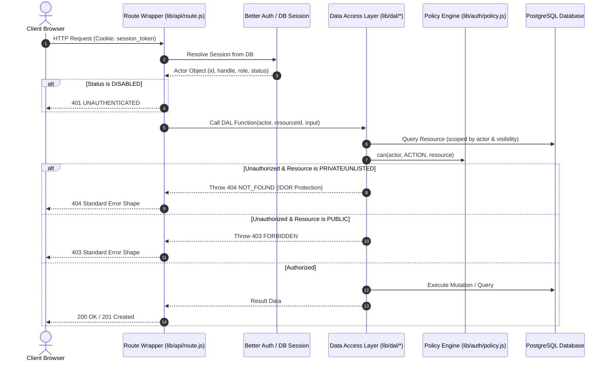
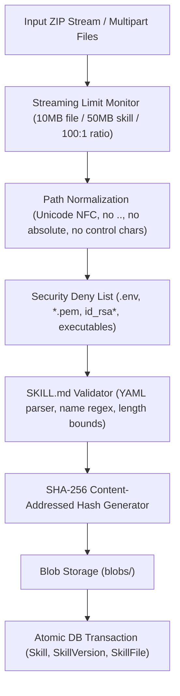
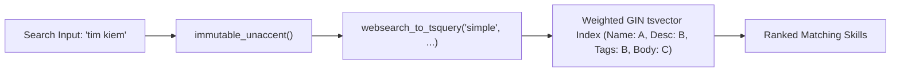

# SkillVault Architecture

This document describes the architectural principles, data flow, component boundaries, and security patterns of SkillVault.

---

## 1. System Topology

SkillVault is architected as a **single deployable** container running Next.js App Router on Node.js, backed by PostgreSQL and an S3-compatible object store.

---

## 2. Component Layering and Isolation

SkillVault strictly enforces layered boundaries. The frontend, route handlers, data access layer, policy engine, and database communicate in one direction only:

### Strict Layering Rules (Enforced by ESLint)

1. **Prisma Client Isolation**: Only `lib/dal/*` and `lib/auth/*` may import `lib/db.js`. Route handlers and UI components are strictly forbidden from calling Prisma or raw database queries directly.
2. **Actor Scoping**: Every function in `lib/dal/*` accepts `actor` (the authenticated user object or `null`) as its first parameter and applies ownership and visibility filters directly inside the SQL `where` clause.
3. **No Server Actions**: All state mutations must flow through explicit HTTP Route Handlers wrapped by `lib/api/route.js`. This ensures predictable CSRF origin checks, schema validation, rate limiting, and centralized error logging.

---

## 3. Authentication & Authorization Flow

SkillVault treats the **PostgreSQL database as the sole source of truth for identity and permissions**.

### Authorization Rules (`lib/auth/policy.js`)

- `SKILL_READ`: Owner can read any skill; anyone can read `PUBLIC` skills; `UNLISTED` skills are accessible only with the exact `shareToken`; `PRIVATE` skills are invisible to everyone except the owner.
- `SKILL_WRITE` & `SKILL_DELETE`: Only the owning user may modify metadata, upload new versions, or soft-delete a skill.
- `SKILL_FORK`: Permitted for the owner, for any logged-in user on a `PUBLIC` skill, and via valid `shareToken` for an `UNLISTED` skill.

---

## 4. Ingestion Streaming Pipeline

Untrusted skill archives and files are ingested via a unified streaming pipeline (`lib/skills/ingest.js`):

### Deduplication and Content Addressing

- Every file is hashed with server-calculated SHA-256 (`blobSha256`).
- Identical files across multiple skills or versions point to the same row in `Blob`.
- Forking a skill creates a new `Skill` and `SkillVersion` record, but reuses existing `SkillFile` rows pointing to existing blobs without duplicating storage.

---

## 5. Full-Text Search Architecture

Search across public skills (`/explore`) and owner libraries (`/dashboard`) is powered by PostgreSQL full-text search:

1. **Accents Invariance**: The database uses an `immutable_unaccent` function wrapper to ensure searches like `tim kiem` match `tìm kiếm`.
2. **Deterministic Cursor Pagination**: Results are paginated via keyset cursor pagination with composite tie-breakers on `(updatedAt, id)` or `(name, id)` to prevent duplicate or skipped items across pages.
